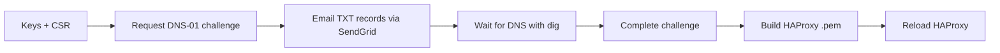

# Ansible Let's Encrypt for HAProxy (DNS-01)

An Ansible playbook that gets Let's Encrypt SSL certificates using the DNS-01 challenge and deploys them to HAProxy.

It's built for setups where you can't automate DNS changes. The playbook emails the TXT records to your DNS admin, waits until the records are live, finishes the challenge and reloads HAProxy.

> **Status:** Working tool, still in progress. See [Roadmap](#roadmap).

## What it does

1. Creates the `/etc/letsencrypt` folders (`account`, `certs`, `csrs`, `keys`)
2. Generates a Let's Encrypt account key if one doesn't exist
3. Generates a private key and CSR for each domain
4. Requests the DNS-01 challenge from Let's Encrypt
5. Emails the TXT records to the DNS admin through SendGrid
6. Checks DNS with `dig` until the TXT records show up (every 60 seconds, up to 10 tries)
7. Completes the challenge and downloads the certificate, chain and full chain
8. Combines the full chain and private key into a `.pem` file for HAProxy
9. Reloads HAProxy



Certificates are renewed when they have fewer than 60 days left.

## Requirements

**Control node**
- Python 3.9
- Ansible 2.9 and the packages in `requirements.txt` (includes the `sendgrid` library)
- `dnspython` for the `dig` lookup
- A SendGrid API key

**Target hosts**
- `bash` and `openssl`
- HAProxy installed and running
- SSH access with sudo (the playbook uses `become: true`)

## Project structure

```
.
├── ansible.cfg                 # Uses the local "hosts" inventory
├── main.yml                    # Main playbook
├── tasks/
│   └── generate.yml            # Private key and CSR generation per domain
├── filter_plugins/
│   └── path_filter.py          # path_join filter for building file paths
├── requirements.txt            # Python dependencies
└── runtime.txt                 # Python version
```

You need to create `hosts` and `vars/vars.yml` yourself (see below).

## Setup

**1. Clone the repo and install dependencies**

```bash
git clone https://github.com/jamesadjinwa/ansible.cerbot.git
cd ansible.cerbot
python3 -m venv venv
source venv/bin/activate
pip install -r requirements.txt dnspython
```

**2. Create the inventory file `hosts`**

```ini
[haproxy]
lb01.example.com ansible_user=ubuntu
```

**3. Create `vars/vars.yml`**

```yaml
# Domains to get certificates for
domain_names:
  - example.com
  - app.example.com

# Let's Encrypt
acme_directory: https://acme-staging-v02.api.letsencrypt.org/directory  # staging, switch to production when ready
acme_version: 2
acme_email: admin@example.com
acme_challenge_type: dns-01

# Paths on the target host
letsencrypt_account_key: /etc/letsencrypt/account/account.key
letsencrypt_keys_dir: /etc/letsencrypt/keys
letsencrypt_csrs_dir: /etc/letsencrypt/csrs
letsencrypt_certs_dir: /etc/letsencrypt/certs
haproxy_cert_dir: /etc/haproxy/certs

# SendGrid email to the DNS admin
sendgrid_api_key: "your-sendgrid-api-key"
sendgrid_from_address: certs@example.com
sendgrid_subject: "Please add these DNS TXT records"
sendgrid_to_addresses:
  - dnsadmin@example.com
```

Production directory: `https://acme-v02.api.letsencrypt.org/directory`

Tip: keep the SendGrid API key in Ansible Vault instead of plain text.

```bash
ansible-vault encrypt_string 'your-sendgrid-api-key' --name 'sendgrid_api_key'
```

## Usage

```bash
ansible-playbook main.yml
```

With Vault:

```bash
ansible-playbook main.yml --ask-vault-pass
```

After the email goes out, the DNS admin adds the TXT records. The playbook waits for them, then finishes on its own. It also pauses 10 minutes for DNS propagation, so expect a full run to take at least 10 to 20 minutes.

## Output files

| File | Location |
|------|----------|
| Account key | `letsencrypt_account_key` |
| Private key | `{{ letsencrypt_keys_dir }}/<domain>.key` |
| CSR | `{{ letsencrypt_csrs_dir }}/<domain>.csr` |
| Certificate | `{{ letsencrypt_certs_dir }}/<domain>.crt` |
| Chain | `{{ letsencrypt_certs_dir }}/chain_<domain>.crt` |
| Full chain | `{{ letsencrypt_certs_dir }}/fullchain_<domain>` |
| HAProxy PEM | `{{ haproxy_cert_dir }}/<domain>.pem` |

Point HAProxy at the PEM folder in your `bind` line:

```
bind *:443 ssl crt /etc/haproxy/certs/
```

## Roadmap

- [ ] Fix private key and CSR generation order in `tasks/generate.yml`
- [ ] Fix the private key check path in `main.yml`
- [ ] Add `vars/vars.yml.example` and `hosts.example`
- [ ] Turn the playbook into a reusable Ansible role
- [ ] Update to a current Ansible version
- [ ] Optional DNS provider API support (Cloudflare, Route 53) to skip the manual email step
- [ ] Add support for `www` and other SAN entries per domain

## Credits

- [Felix Fontein](https://github.com/felixfontein) ([acme-certificate repository](https://github.com/felixfontein/acme-certificate))
- [Jamie Scaife](https://www.digitalocean.com/community/users/jamieweb) and [Kathryn Hancox](https://www.digitalocean.com/community/users/khancox) ([DigitalOcean tutorial](https://www.digitalocean.com/community/tutorials/how-to-acquire-a-let-s-encrypt-certificate-using-ansible-on-ubuntu-18-04))

## Author

James Adjinwa ([GitHub](https://github.com/jamesadjinwa))
